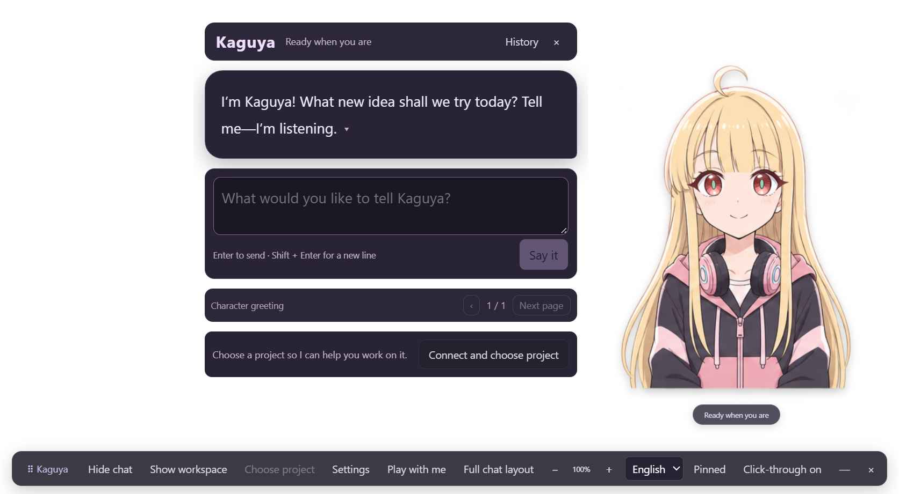
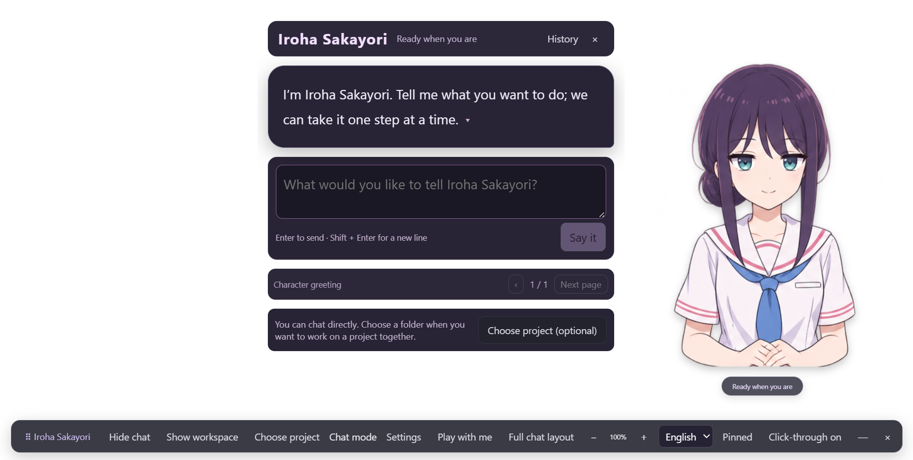
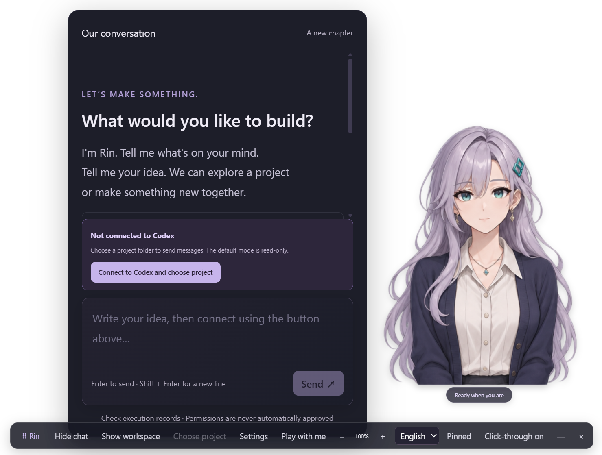
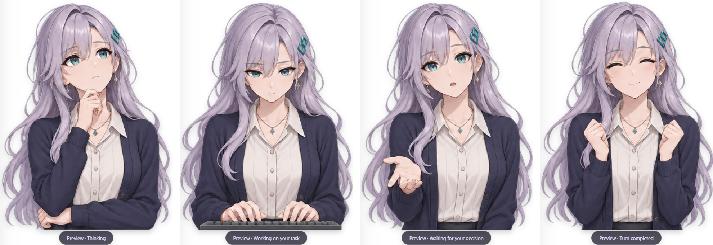
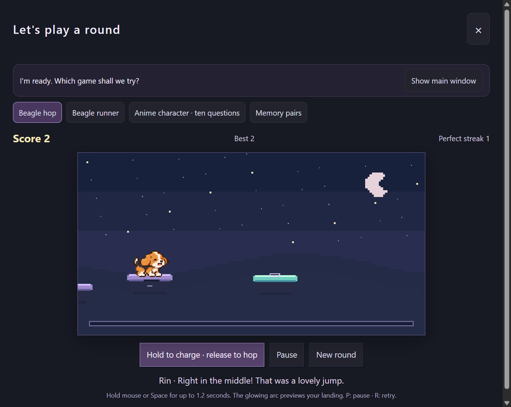
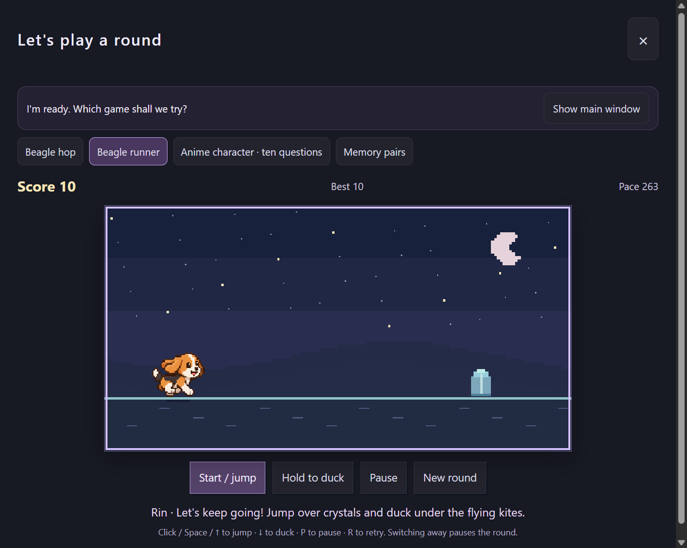
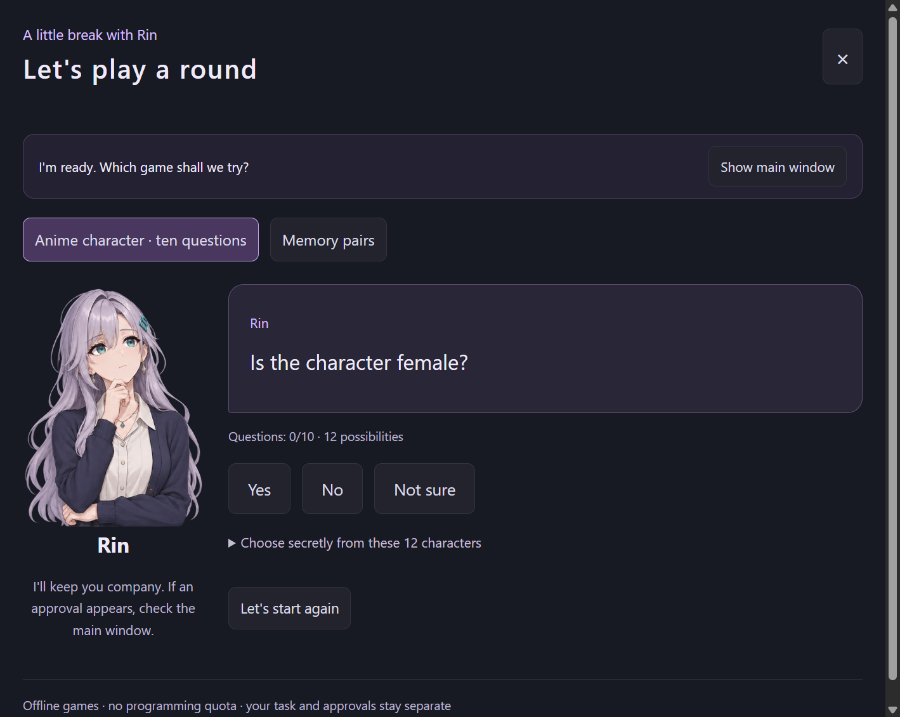

> **0.18.6 desktop companion preview:** Resident desktop pet with Codex / Claude Code task delegation, model and effort selection, persistent companion memory, research-backed character creation, animated activity transitions and an interactive first-run guide. Current visual tuning targets the Furina sticker appearance. See [automatic character creation](docs/AUTOMATIC_PET_PRODUCTION.md), [activity transitions](docs/ALL_ACTIVITY_TRANSITIONS.md), and [validation](docs/VALIDATION.md). This is a source preview; download links below still point to the previously published 0.7.0 installers. Local 0.18.6 validation covers macOS Apple Silicon, not fresh Windows or Intel release acceptance.

> **0.10.0 companion preview:** The default interface is now a resident character with separate conversation, memory and native-worker tasks. Read [the companion guide](docs/SUPERAGENT.md) for usage, data storage, file feeding and current limits.

> 本机开发版 0.9.0：Codex 原生权限继承、模型与 effort 选择、Mori 风格角色工作室，以及新版分区设置。见 [本地 Agent 与角色工作室](docs/LOCAL_AGENT.md)。

# Anime Codex

**Development 0.8.0:** selectable local Claude Code with independent English prompt polishing and Chinese reply translation through your locally signed-in Codex subscription. See [Claude setup, environment inheritance and validation](docs/CLAUDE.md). The release download links below still refer to the published 0.7.0 packages.

A transparent Windows and macOS desktop programming companion powered by the **real Codex App Server**. Upload your own character images, talk naturally, and watch the character change expression as Codex actually works.

**UI languages:** Simplified Chinese, English and Japanese, selectable from the desktop toolbar. The preference is saved locally. Repository documentation is maintained in English.

**Platform support:** Version 0.7.0 supports macOS 14+ builds for Apple Silicon and Intel, alongside Windows x64. Mac packages are ad-hoc signed development builds without Apple notarization; see [Mac installation](docs/MACOS.md). Version-specific verification is recorded in [validation evidence](docs/VALIDATION.md).

**Get started:** [Install on a Mac](#install-on-a-mac) · [Install on Windows](#install-on-windows) · [Troubleshooting](#installation-troubleshooting) · [Character features](#meet-rin) · [Build from source](#build-from-source-for-developers)

## Install on a Mac

**You do not need Node.js, npm or Git to use the downloaded application.**

1. Install the official Codex backend using the [macOS CLI guide](https://learn.chatgpt.com/docs/codex/cli), then run `codex login` in Terminal and complete sign-in. If you already use a native, signed-in Codex CLI, keep that installation.
2. Open **Apple menu → About This Mac**. Download **[Apple Silicon .dmg](https://github.com/Lihhan/anime-codex/releases/download/v0.7.0/Anime-Codex-0.7.0-mac-arm64.dmg)** for an Apple M-series chip, or **[Intel .dmg](https://github.com/Lihhan/anime-codex/releases/download/v0.7.0/Anime-Codex-0.7.0-mac-x64.dmg)** for an Intel processor. macOS 14 or later is required. Downloads are private; sign in to an authorized GitHub account.
3. Open the **.dmg**, drag **Anime Codex.app** into **Applications**, eject the disk image, then open the app from Applications. If Gatekeeper blocks this ad-hoc-signed development build, follow the [documented first-launch steps](docs/MACOS.md#if-macos-blocks-the-first-launch).
4. Select **English** to match these instructions. Click **Connect and choose project**, then select the folder you want help with.
5. Type in the input below Rin's bubble and press **Return** or click **Say it**. The default permission is **Read-only**.

**[Full Mac guide: installation, sign-in, first launch and troubleshooting](docs/MACOS.md)**

Finder/Dock launches do not need Terminal's PATH: the app also checks the standalone installer's `~/.local/bin/codex`, common Homebrew paths and common desktop app bundles. If needed, use **Settings → Choose Codex executable and connect** to select your native Mac `codex` file. **Command+Option+A** reveals a hidden overlay. See the full guide for source builds and the Intel-specific local inference runtime.

## Install on Windows

**Recommended: download the ready-to-run application. You do not need Node.js, npm, Git or any build commands for this method.**

You need a **Windows x64 computer** (Windows 11 recommended), an internet connection for Codex, and access to an official Codex account/backend. Anime Codex is the character interface; the separately installed Codex backend does the programming work.

### 1. Prepare Codex once

**Already using the official Codex desktop app on this Windows computer?** Open it and confirm you can sign in and send a request. You can then continue to step 2. Anime Codex attempts to find the native backend installed with supported Codex desktop versions automatically.

**No Codex installation yet?** Follow OpenAI's [official Windows setup guide](https://developers.openai.com/codex/app/windows/) or [Codex CLI installation guide](https://developers.openai.com/codex/cli/) and complete sign-in. For the CLI guide, select **Windows** and install on Windows itself. A backend installed only inside WSL cannot be selected by this version of Anime Codex.

If you use the CLI, open **Start → type PowerShell → open Windows PowerShell**, then run these commands one at a time:

```powershell
codex --version
codex login
codex login status
```

Complete the browser sign-in when asked. The first command should print a version; the last should confirm a signed-in account. If `codex` is not recognized, see [Codex cannot be found](#codex-cannot-be-found). Do not enter your password or copy login tokens into Anime Codex.

### 2. Download Anime Codex

1. Open [Anime Codex 0.7.0 downloads](https://github.com/Lihhan/anime-codex/releases/tag/v0.7.0).
2. Expand **Assets** if necessary.
3. Click **Anime.Codex.0.7.0.exe** and save it somewhere easy to find, such as a new `Anime Codex` folder in Documents.

**[Download Anime.Codex.0.7.0.exe directly](https://github.com/Lihhan/anime-codex/releases/download/v0.7.0/Anime.Codex.0.7.0.exe)**

Choose the **.exe**, rather than GitHub's **Source code (zip)** or **Source code (tar.gz)**. Those archives contain code and need the developer build steps below. The repository and downloads are private: sign in to a GitHub account with repository access. A 404 usually means you are signed out or do not have access.

### 3. Double-click the downloaded file

Close an older Anime Codex instance first, then double-click **Anime.Codex.0.7.0.exe**. This is a **portable application**: there is no installation wizard. Wait for Rin and the bottom toolbar to appear; first launch can take longer while the application extracts its bundled files.

This development build is unsigned. If Windows displays a SmartScreen warning, verify you downloaded it from this repository. If Windows offers **More info → Run anyway**, use that only after verifying the source. Organization-managed computers may require administrator approval; do not disable Windows protection to launch it.

### 4. Connect and choose a project

1. Select **English** on the bottom toolbar to match the button names in this guide. Chinese and Japanese are also available.
2. Click **Connect and choose project** below the dialogue/input area. In the full chat layout, the button is **Connect to Codex and choose project**.
3. In the folder picker, select the folder you want help with, then click **Select Folder**. You can create an empty folder in Documents if you just want to try the app.

**You are connected when the chosen folder appears on the toolbar and the connection prompt disappears.** Opening the official Codex app alone does not connect Anime Codex. You must choose a project here, even for an introductory conversation.

### 5. Send your first message

Type this in the input **directly below Rin's dialogue bubble**, then click **Say it** or press **Enter**:

> Introduce yourself, then list the files in this project. Do not modify anything.

Rin's reply should stream into the bubble. Click **History** to see the complete conversation and real tool records. **Shift+Enter** inserts a new line. Clicking the bubble or **Next page** only reveals/pages through dialogue; it does not send a message.

**Read-only is the default**, so the first test does not permit file changes. To let Codex edit a project later, follow [Allow project edits](#allow-project-edits).

For later launches, double-click the same **.exe**, reconnect and select your project. Your character library, copied images, language and appearance settings are saved locally.

### Allow project edits

1. Finish or stop any running task.
2. On the bottom toolbar, click the button showing your **current project folder name** (or **Choose project** if none is selected) and select the intended folder again. This clears the active conversation selection.
3. Open **Settings → Permissions for new or resumed conversations** and choose **Project write (can modify the selected folder)**.
4. Close Settings with its top-right **×**, then send a new request to start a conversation with that permission mode.

This permits changes inside the selected project without asking about every file. Commands that need approval still show an explicit decision dialog. Read the command, folder and reason before deciding. Changing the setting does not change permissions for a task already running.

### Upgrade or remove the app

- **Upgrade:** close the old app, download the newer **.exe** from [Releases](https://github.com/Lihhan/anime-codex/releases), and open the new file. Keep your existing application data to preserve characters and settings.
- **Remove the application:** close it and delete the downloaded **.exe**. It has no installer/uninstaller.
- **Local data:** preferences and copied character images are stored separately in `%APPDATA%\anime-codex\`. Removing the **.exe** does not erase them. Only delete that data folder if you intentionally want to discard your library and settings.

## Installation troubleshooting

| What you see | What to do |
|---|---|
| GitHub shows 404, or the download will not open | Sign in to GitHub with an account that has access to this private repository. |
| The downloaded ZIP contains no application | You downloaded source code. Get the **.exe** under release **Assets**, or follow [Build from source](#build-from-source-for-developers). |
| Rin appears, but **Say it** is disabled | Click **Connect and choose project**, complete Codex sign-in if required, and select a folder. Sending is also disabled during an active task or pending approval. |
| `spawn codex ENOENT` or “Codex backend was not found” | Use the current release and follow [Codex cannot be found](#codex-cannot-be-found). |
| “Codex is not signed in” | Run `codex login` in Windows PowerShell, complete browser sign-in, then retry the connection. If the command is unavailable, use the native executable method below. |
| Windows warns about an unknown publisher | This build is unsigned. Verify the repository/download source; follow your organization's software policy. |
| The character or toolbar is hidden, docked or difficult to click | Press **Ctrl+Alt+A** to reveal the overlay and restore mouse input. |
| `node`, `npm` or `git` is not recognized while building | Install the tools listed in [Build from source](#build-from-source-for-developers), then close and reopen PowerShell. These tools are not needed for the downloaded app. |
| PowerShell says `npm.ps1` cannot run | Use the documented `npm.cmd` commands below; there is no need to change PowerShell's execution policy. |

### Codex cannot be found

Anime Codex needs a **native Windows `codex.exe`**, not an npm `codex.cmd`/`codex.ps1` launcher or a Linux/WSL executable.

1. Open **Settings** on the bottom toolbar.
2. Click **Choose Codex executable and connect**.
3. Select the native `codex.exe` from your official Windows Codex installation. The successful choice is remembered.
4. Close Settings, click **Choose project** on the bottom toolbar (or the current folder name if one is shown), select your folder, then try sending again.

For the supported Codex desktop installation layout, press **Win+R**, paste `%LOCALAPPDATA%\OpenAI\Codex\bin`, and press Enter. Open the appropriate version folder to find `codex.exe`. If that folder does not exist, your installation uses another layout; use the path from the official installer instead. For a standalone CLI installation, `(Get-Command codex.exe).Source` in PowerShell can show its native executable path when it is on PATH.

If you need to sign in using that file, open Windows PowerShell and run the following, **replacing the example path with your actual `codex.exe` path**:

```powershell
& "C:\path\to\codex.exe" login
& "C:\path\to\codex.exe" login status
```

Do not select a similarly named executable from an untrusted project folder. If you previously set `CODEX_PATH` to a file that no longer exists, correct or remove that setting and restart Anime Codex. [Official sign-in documentation](https://developers.openai.com/codex/auth/) explains Codex authentication.

## Choose a character

Open **Settings → Character library** and click a character card. Rin remains the original default, and your existing custom characters stay in the library.

| Character | Appearance | Conversation style |
|---|---|---|
| Rin | Original silver-haired companion | Calm, warm and encouraging |
| Furina | Fontaine-inspired outfit and hat | Theatrical confidence, with sincere care beneath the bravado |
| Nahida | Leaf-inspired white/green outfit | Gentle curiosity, patient reasoning and grounded analogies |
| Kaguya | Real-world blonde hair, headphones and pink/black casual clothing | Energetic, direct, spontaneous and eager to try ideas |
| Iroha Sakayori | Real-world dark-purple hair, low bun and sailor uniform | Responsible, practical and quietly caring, with occasional dry humor |

Kaguya and Iroha use their **real-world appearances**, rather than their Tsukuyomi virtual avatars. Each fan preset includes eight transparent expressions/poses, three-language greetings, a configurable personality and character-specific hair/shoulder/hand reactions. The existing state machine connects their work poses to real Codex events. These are image-based portraits with transitions, not Live2D models.





These captures show local welcome greetings with no project connected; they do not represent executed tasks. Connected replies stream from the real Codex backend. Touch reactions are local feedback and never stand in for tool results.

Switching characters starts a fresh conversation selection so previous replies do not appear under a different identity. Existing Codex threads remain available in History. Switching is disabled while a task or approval is active. Editing a bundled character creates a custom copy; the protected original remains available. Upload your own artwork as before, including idle-only fallback.

The four franchise presets are **unofficial generated fan art and newly written personality interpretations**. They do not reproduce official voices or claim canonical accuracy or endorsement. The code's MIT license does not license the underlying character IP. See [asset provenance and rights](characters/FANART.md).

## Meet Rin

**Original Rin is included in the character library and selected on a fresh install.** Her calm, warm personality and eight expressions use the same image system as custom characters. Editing the original creates a custom copy, preserving the bundled template. **Settings → Use original Rin** restores her original appearance without deleting your custom character. Upgrading also preserves previously modified Rin profiles as custom copies before repairing the original template.



Actual application capture, with no project connected. The surrounding area is transparent; the dialogue bubble is optional. This is the welcome screen, not a claimed task execution.



These are the application's explicitly labeled **Preview** states. Real task states follow Codex events. Speaking reuses the listening image; interrupted reuses idle. See [artwork provenance](characters/ASSETS.md).

## Talk and play with Rin

The default **visual-novel dialogue** places a speech bubble beside your character, with a nameplate and progressive text. The bubble contains only character dialogue. A compact, always-visible free-text input sits directly below it; there are no preset response choices. Drafts stay intact when switching between bubbles and the full transcript during the session. Task status, errors and navigation remain outside the speech bubble.

Click the dialogue to reveal the current page or advance to the next page. **Paging only changes the display; it never sends an instruction.** Type below the bubble and select **Say it**, or press Enter, to send your own message. Shift+Enter adds a line. Sending stays disabled until a project is connected and while a task or approval is pending.

Replies stream from Codex without paraphrasing or fabricated results. Long replies are paginated while preserving every original character, including code and whitespace. **History** opens the complete transcript with tools and diffs; **Back to bubbles** returns to the character. Pending approvals keep their explicit main-window decision dialog. A new task never presents an old reply as its current progress.

Use the toolbar layout button or **Settings → Dialogue layout** to switch between bubbles and the full chat layout. Your choice persists across restarts. Both layouts support Chinese, English, Japanese, adjustable text size and reduced-motion settings.

Conversation text now defaults to **18 px**, with a persistent **14–24 px** setting under **Settings → Reading and interaction**. Messages, the composer and welcome text use the same size, with stronger contrast. Avatar scaling does not change text size.

Rin addresses you in the first person. The real Codex backend receives that character-voice instruction for new/resumed conversations; original tool output and execution results stay verbatim. Existing stored replies are not rewritten.

Tap her **hair, shoulders or hands** for a short playful reaction, a smile when available, and a sway, giggle or bounce. Transparent pixels and letterboxing do not respond. Move more than six pixels to drag instead. Reactions have a cooldown, respect reduced motion and can be disabled. Real work poses/status take precedence while programming. These scripted reactions appear outside the programming transcript.

Choose **Play with me** to open a separate, resizable window:

- **Anime character · ten questions:** secretly choose from the displayed 12-character offline roster. Rin asks yes/no/not-sure questions and makes a guess within ten questions. Arbitrary characters outside that roster are not supported yet.
- **Memory pairs:** find six matching pairs, with feedback, a turn counter and replay.
- **Beagle hop:** hold the mouse or Space, then release to jump between floating islands. Charge controls distance, a glowing arc previews the landing, and center landings earn bonus points and a perfect streak.
- **Beagle runner:** click, Space or ↑ to jump over crystals; hold ↓ to duck under low flying kites. The pace increases as the run continues.





Both action games use an original **pixel-art beagle** with eight action frames, independently of Rin or the selected character. Stars, platforms, terrain and obstacles use a 400×210 canvas with nearest-neighbor scaling and no smoothing. Pause, replay, local best scores and reduced decorative motion are supported. Switching tabs, losing focus or receiving an approval pauses the round; resuming is explicit. Switching back preserves the round until the game window is closed. [Controls and mechanics](docs/ARCADE.md) · [Beagle artwork and prompts](public/games/beagle/ASSET.md).



Guessing and memory pairs display the selected conversation character; the action games use the fixed beagle atlas. All games follow the main UI language. **Show main window** minimizes the game without resetting the round; **Play with me** restores it. Closing a game discards that round while your Codex task continues. The work/approval badge follows real backend status. Approvals remain in the main window and require your decision.

Game dialogue and rules run locally without consuming Codex quota. Its restricted window bridge cannot invoke programming tools, answer approvals or access conversation/personality data. See [game details and roster references](docs/PLAY.md).

## Your character, your images

**One idle image is enough.** Upload an idle portrait to create a character. Every other image is optional: any action without its own image automatically uses the idle image.

| Action | When it appears |
|---|---|
| Idle | Ready, with no active task |
| Listening | You are typing |
| Thinking | Codex begins a turn or continues reasoning |
| Reading | Structured read/search activity |
| Working | Commands or file modifications |
| Awaiting approval | A server request needs your decision |
| Speaking | A streamed reply, or optional TTS playback |
| Success | The server completes a turn |
| Sorry / failure | A failed turn or a disconnected backend |
| Stopped | You interrupt a turn |

Import PNG, JPEG or WebP files separately for the actions you want. Transparent PNG is recommended for a background-free desktop character. Backgrounds are retained by default; optional local AI can remove them. The app does not generate characters, rig them or change their facial artwork. There is no Face Studio or procedural skin mode.

In **Settings → Character library**, create another character, rename it, edit its personality, replace individual images or restore an optional action to idle fallback. Preview is clearly labeled and does not execute a task. Files are copied locally, not uploaded to Codex or GitHub. See [character setup](docs/CHARACTERS.md).

## Local automatic background removal

Enable **Automatically remove background on import** in Character library, or click **Remove background** for an image you already imported. Each action keeps its own original copy; **Restore original** returns to that copy. Removing a background changes alpha only, preserving RGB colors, dimensions and alignment. If processing fails or is cancelled, the current image remains unchanged.

The first operation downloads a pinned 176,069,933-byte Anime Segmentation model (about 168 MiB), verifies SHA-256, and caches it under the application's local `models/` directory. Later operations work offline. Character images are never uploaded, and image processing does not require Codex login or consume Codex quota. Download/inference progress can be cancelled. Processing runs in the background so the desktop UI remains responsive; Intel Mac uses a separate utility process to isolate the compatibility runtime during cancellation.

The first model is optimized for anime illustrations. If its result would remove almost the entire visible foreground, the app tries a small general foreground model (U2NetP, an additional 4,574,861-byte download). Both downloads are checksum-verified and cached. If neither result retains a substantial foreground, processing is rejected and the original stays in place. On startup, old near-empty processed assignments with saved originals are restored automatically. This is a conservative transparency check, not a guarantee of correct person recognition; tiny subjects, fine hair and complex backgrounds can still need a different image or a prepared transparent PNG. Already-transparent pixels remain transparent. Original source files are never overwritten. Model/runtime sources and licenses are in [third-party notices](THIRD_PARTY_NOTICES.md).

## Desktop behavior

- Drag the character or the dotted toolbar handle to move it.
- Resize with minus/plus, the Settings slider, or Alt + mouse wheel (50–180%).
- Drag near any screen edge to collapse to a small tab; hover over or click it to restore.
- Pending approvals prevent hiding; a new approval request automatically reveals the UI.
- Toggle always-on-top and transparent-area click-through. `Ctrl + Alt + A` (Windows) or `Command + Option + A` (Mac) reveals the overlay and restores mouse input.
- Position, scale, selected character, action images, personality, auto-hide and language survive restarts.
- Close Character and connection with its top-right × or Escape. The close control stays visible while scrolling. Closing preserves unsaved input; use Save character to persist profile edits. Escape does not dismiss an approval or cancel image processing.

## Real Codex capabilities

The application uses the official `codex app-server --listen stdio://` transport. It preserves streamed replies, persistent threads, tool activity, command output and exit codes, progress, diffs and one-time permission approvals. It displays original Codex text rather than rewriting execution results through a separate character model.

A success image means the server completed the turn; it does not guarantee that all tests passed. Failures, unsupported requests and unverified results remain visible. The character's presentation never grants permissions or substitutes for actual execution evidence.

## Language and local data

The language selector translates application controls, settings, action labels, local errors and native picker titles. It also sets the response-language preference for new/resumed Codex conversations and the preferred system TTS language. Existing replies, tool output, code, diffs and server-supplied requests remain verbatim. Changing language mid-turn does not rewrite that turn's instructions.

Preferences and copied images live in `%APPDATA%\anime-codex\` on Windows and normally `~/Library/Application Support/anime-codex/` on macOS. Uploaded images are never sent to Codex or GitHub; your chosen name and personality are included in conversation instructions. System voices vary by operating system and installation. TTS is optional; image switching is not phoneme-accurate lip synchronization.

## Build from source (for developers)

**Skip this section if you downloaded the ready-to-run .exe.** Use it only to change the code or build your own copy.

1. Install **Node.js 24 with npm** from [nodejs.org](https://nodejs.org/en/download) and **Git for Windows** from [git-scm.com](https://git-scm.com/downloads/win). Keep their normal PATH options enabled.
2. Close and reopen **Windows PowerShell** after installation. Check that these commands print versions:

```powershell
node --version
npm.cmd --version
git --version
```

3. Run the following commands **one line at a time**. Complete the GitHub sign-in prompt if it appears; your account needs access to this private repository.

```powershell
git clone https://github.com/Lihhan/anime-codex.git
Set-Location anime-codex
npm.cmd ci
npm.cmd run build
npm.cmd start
```

Keep that PowerShell window open while the application runs. Rin and the toolbar should appear after the final command. Then follow [Connect and choose a project](#4-connect-and-choose-a-project). Installing the source dependencies does not install or sign in to the Codex backend.

If you already downloaded and extracted **Source code (zip)**, open the extracted folder in PowerShell and start at `npm.cmd ci`; do not run `git clone` inside it. Run all npm commands in the folder containing `package.json`. The first dependency download can take several minutes. If Electron's runtime was not downloaded, run `node node_modules/electron/install.js`, then retry.

For development with automatic UI reload, use `npm.cmd run dev`. To create a portable Windows executable, run:

```powershell
npm.cmd run dist:win
```

The current output is `release/v0.7.0/Anime Codex 0.7.0.exe`. The build does not bundle Codex or account credentials. Downloaded releases provide `SHA256SUMS.txt`; you can compare it with `Get-FileHash -Algorithm SHA256 -LiteralPath '.\Anime.Codex.0.7.0.exe'` in the folder containing your downloaded executable.

## Test and package

```powershell
npm.cmd test
npm.cmd run build
npm.cmd run smoke:ui
npm.cmd run smoke:gal
npm.cmd run smoke:customization
npm.cmd run smoke:play
npm.cmd run smoke:arcade
# Real handshake/account read with an empty PATH, including restart persistence:
npm.cmd run smoke:connection
# Optional real local AI check (downloads the model if missing):
$env:RUN_REAL_BACKGROUND = '1'
npm.cmd run smoke:background -- path/to/character.png
$env:RUN_REAL_CODEX = '1'
npm.cmd run smoke:backend
npm.cmd run smoke:desktop
npm.cmd run smoke:gal-real
npm.cmd run dist:win
```

Real-backend tests use your Codex quota. They operate on disposable fixture directories. UI-only action/approval events are explicitly marked test fixtures, not claimed execution results. UI tests use isolated application data directories and do not change your own character library.

See [validation evidence](docs/VALIDATION.md). Windows Actions checks run unit tests, the production build, UI/customization checks and dependency audit. The separate macOS workflow runs on Apple Silicon and Intel runners and builds DMG/ZIP artifacts after source checks, real unauthenticated backend handshakes and local inference checks. Packaged Mac startup and native inference are checked before artifacts are uploaded. A local pass does not claim that an uninspected remote Actions run passed.

## Boundaries and implementation

Electron main owns the Codex subprocess, native file pickers, validated imports, persistent settings and desktop layout. The renderer has no Node access. Context isolation, renderer sandboxing, CSP, navigation blocking and fixed IPC endpoints remain enabled. Approvals must match a live request ID; there is no permanent or automatic approval path and no silent full-access retry. Advanced permission grants and MCP elicitation currently support conservative refusal only.

The UI uses image crossfades and subtle presentation motion. It does not include a deformable avatar rig, Live2D/Core runtime, face editor, automatic portrait rigging, speech input or emotional voice synthesis. Optional action images are your own artwork; one idle image remains sufficient for every task state.

## License and repository

Code: MIT. Dependencies retain their own licenses. Rin's original AI-generated sample artwork has a [provenance record](characters/ASSETS.md). Your imported images are not relicensed by this project. See [reuse evaluation](docs/REUSE.md).

Repository: [Lihhan/anime-codex](https://github.com/Lihhan/anime-codex), private, default branch `main`. Do not commit personal images, application data, `test-results/`, credentials, `.env` or local Codex settings.
