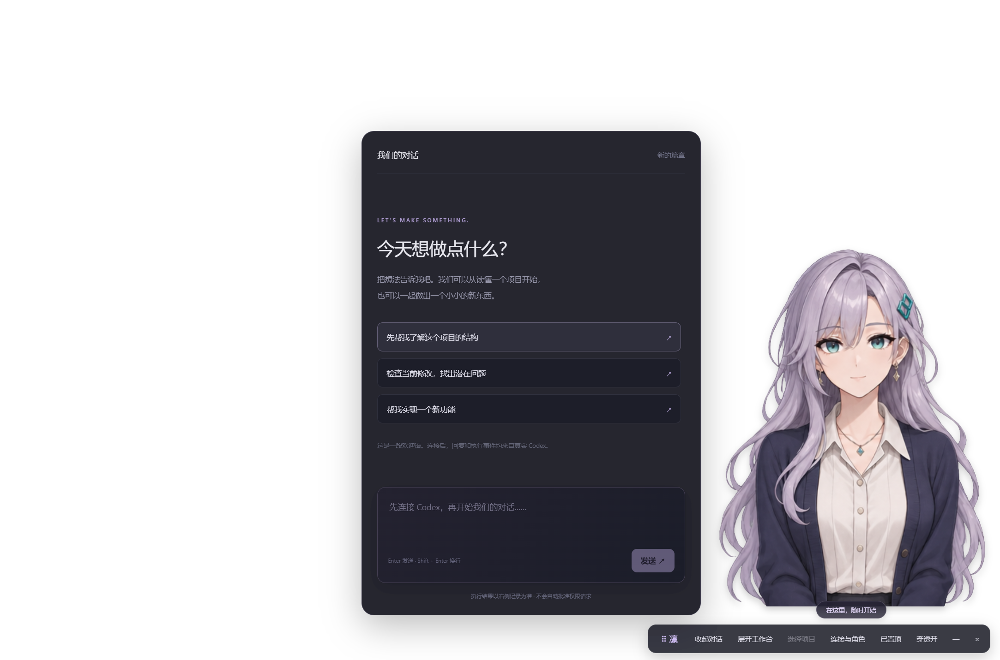

# Anime Codex · 凛

Windows 桌面上的二次元编程伙伴。原创角色「凛」直接以无背景角色出现在桌面，用自然中文与你交流；真正读代码、改文件、调用工具的是本机 **Codex App Server**。

默认是无边框透明窗口：角色没有画框、背景或插图卡片。对话可收起，只留下角色与小控制条；需要时展开完整工作台查看线程、进度和 diff。透明空白区支持鼠标穿透，角色和功能面板可以交互；拖动控制条上的「⠿ 凛」移动窗口。可切换置顶、最小化与关闭。当前角色是腰部以上透明立绘，并非全身 Live2D 模型。



## 现在能做什么

- Electron + React 桌面应用，官方 `codex app-server --listen stdio://` 后端，无模拟成功结果。
- 原创八状态 PNG 图集：待机、倾听、思考、读代码、执行/敲代码、等待审批、成功、失败。呼吸、轻摆、成功动作与 650ms 表情交叉淡化；系统减少动画设置生效。
- 固定角色设定，可在界面编辑自然中文性格；直接展示 Codex 原始流式回复，不再调用另一个模型改写执行结果。
- 按所选项目列出真实线程，分页加载会话与历史；新建、恢复、停止当前任务。
- 显示工具项目、命令输出、退出码、计划、当轮原始 diff，以及最近 500 条原始事件。
- 命令和文件修改请求：单次批准或拒绝。用户问题可输入答案；高级权限和 MCP elicitation 保守拒绝，未知请求明确返回不支持。没有自动审批。
- 可选系统中文 TTS、可替换语音 provider 和音量回调。**未实现 Live2D、精确口型同步、语音输入、情感语音或独立记忆系统。**

角色状态源于服务器事件；「本轮已完成」只表示 Codex turn 完成，不保证所有测试成功。工具退出码和回复中的验证说明仍需阅读。非结构化 shell 命令显示为执行状态，不根据命令字符串猜测读写意图。

## Windows 安装与启动

建议 Windows 11 x64、Node.js 24 LTS（包含 npm）、Git。先安装并登录官方 Codex CLI，或使用已有 Codex 桌面应用附带的原生 `codex.exe`。

```powershell
codex --version
codex login
cd <解压后的 anime-codex 目录>
npm ci
npm run build
npm start
```

开发时使用 `npm run dev`。首次安装/启动 Electron 会下载运行时，需要网络。依赖版本和完整性摘要已锁定于 `package-lock.json`。如果 npm 提示 Electron 安装脚本未运行，可运行 `node node_modules/electron/install.js`。

如果你拿到了已打包的 `Anime Codex 0.1.0.exe`，可直接运行，无需 Node/npm；**仍需本机 Codex 和登录**。这是未签名的开发版，Windows 可能显示发布者验证提示。没有捆绑账户、密钥或 Codex 二进制。

第一次使用：

1. 左下角打开「角色与连接设置」，连接 PATH 中的 Codex，或选择官方 `codex.exe`。
2. 点击左侧「选择一个项目」。应用只接受系统文件夹选择器选中的绝对目录。
3. 默认只读；要写代码，请在**尚未新建线程时**选择「项目内写入」。该模式允许 Codex 修改选中项目，不会逐文件确认；越界请求由 Codex 的策略处理。想改变模式，重新选择项目并开新会话。
4. 发送消息。凛随事件切换状态，右侧查看执行证据；审批时检查完整命令、目录、原因再作决定。
5. 下次选择同一目录，点击左侧历史线程继续。角色设置在恢复线程时重新应用。界面中的临时性格编辑不跨应用重启保存；持久修改请编辑 `characters/rin.json`。

找不到 Codex 时：桌面应用的原生文件通常位于 `%LOCALAPPDATA%\OpenAI\Codex\bin\<版本>\codex.exe`。通过 npm 安装的 `codex.cmd` 是脚本包装，不能作为本应用的原生后端；请选择对应包内的真正 `codex.exe`，或设置进程环境变量 `CODEX_PATH` 为它的完整路径。应用不会经 shell 执行用户输入的可执行文件名。

## 验证与打包

```powershell
npm test
npm run build
npm run smoke:ui
$env:RUN_REAL_CODEX = '1'
npm run smoke:backend
node scripts/smoke-desktop-real.mjs
npm run dist:win
```

`smoke:backend` 会消耗真实 Codex 用量：只在 `test-results/backend-workspace` 生成随机输入，让 Codex 读写该目录，再核对文件、流式片段、历史和恢复。测试请求任何额外权限时自动拒绝；不是产品中的自动批准。`smoke:ui` 是 Electron 自动化检查，审批和失败场景使用明确标记的事件夹具，不声称执行了命令。输出不提交进 Git。

打包输出在 `release/`。详情和已完成验证见 [验收记录](docs/VALIDATION.md)。

## 角色素材、语音与 Live2D

默认 `public/characters/rin/sheet.png` 是 1536×1024 的八格 RGBA 透明 PNG（4列×2行，逐行排列），经实际 alpha 通道检查。修改 `characters/rin.json` 的 `states` 可更换状态映射；替换同规格图集后重新构建。渲染层压低极低透明度边缘，避免背景残留；图集只作为被动图片，不能携带脚本。素材来源、生成提示与使用边界见 [ASSETS](characters/ASSETS.md)。

MVP 的 `SystemVoice` 使用系统 `speechSynthesis`，优先本地中文音色；可用声音取决于系统，有些系统可能没有中文 TTS。代码不会主动上传文字到第三方 TTS。当前音量回调是估计节奏，用作将来口型适配的数据，**当前立绘不具备嘴部形变或真实音频分析**。关闭语音或窗口会取消朗读。

要升级真实感，可先换成分层立绘/逐状态嘴型、手部和眨眼序列，再加入 Live2D renderer。具体扩展契约、模型与授权文件要求见 [角色扩展](docs/CHARACTERS.md)。没有把设置中的 `renderer` 改为 Live2D 就自动加载模型的功能。

## 安全边界与限制

Renderer 无 Node 权限；preload 只暴露固定操作，main 验证调用来源、项目目录、线程和审批请求 ID。`contextIsolation`、renderer sandbox、CSP 启用，阻止窗口导航和新开网页。回复使用 React 文本节点，HTML 不执行。权限由真实 Codex 沙箱、配置和组织策略最终决定；本应用不会降级后重试全权限。

只读/项目写入都使用 `on-request` 和用户审批路由；不提供 `danger-full-access`、持久批准或策略修订按钮。角色 developerInstructions 不替换 Codex baseInstructions。高级权限审批暂只可拒绝。认证沿用本机官方 CLI 登录，应用不读取或保存凭据；账户未登录时请在外部终端完成登录后重启应用。

当前项目以本机 `codex-cli 0.166.0-alpha.5.1` 生成的稳定协议字段实现并验证。App Server 会演进，升级后请跑 smoke 检查；不支持的请求会显示并拒绝，不会静默授予权限。后端异常退出会清除前端执行状态并报错，不能保证恢复中断中的工具任务；重新连接后恢复历史线程。

## 开源与 GitHub

项目源码为 MIT；依赖保留各自许可证，素材另见说明。[候选项目评估与来源](docs/REUSE.md)。

本地已经准备好 Git 仓库；远程发布需要 GitHub 仓库写入权限。未完成授权前，没有远程仓库链接。授权后可使用 GitHub CLI：

```powershell
gh auth login
gh repo create anime-codex --private --source . --remote origin --push
```

默认建议私有仓库；要公开，请按你的实际发布意图选择。不要把 `test-results/`、登录文件、`.env` 或本地 Codex 配置推送到仓库。
